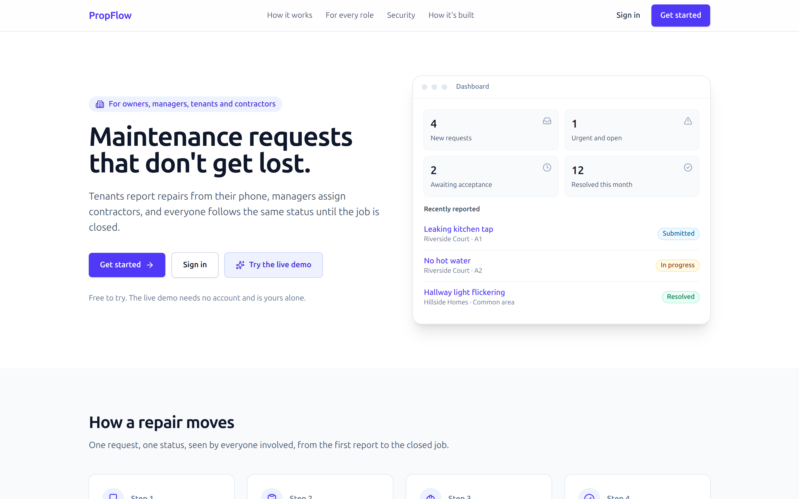
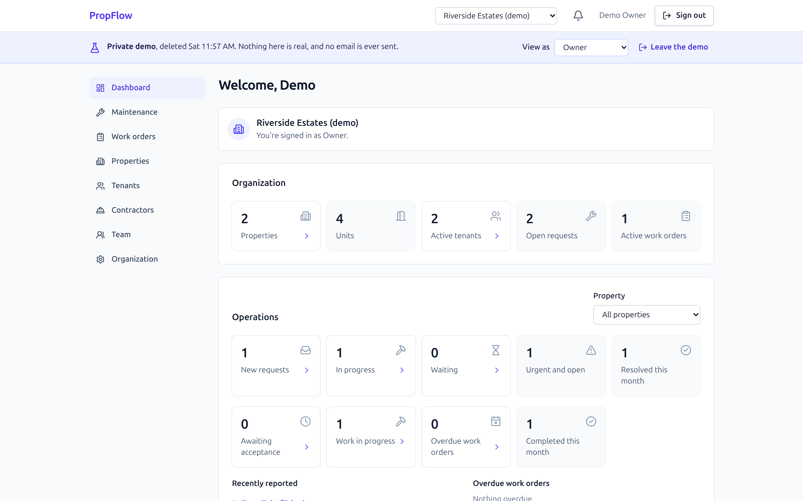
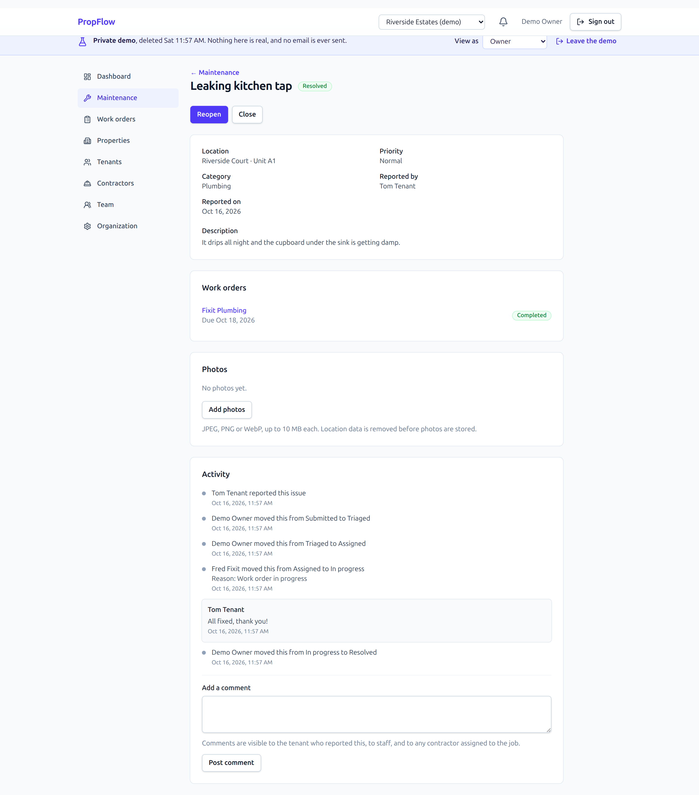
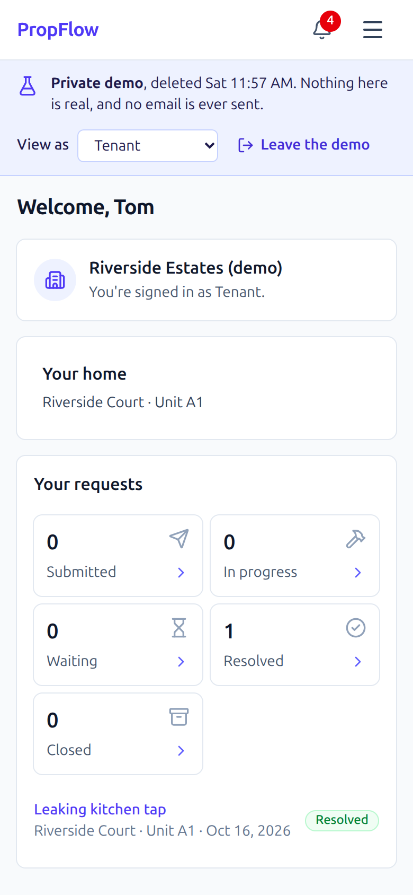
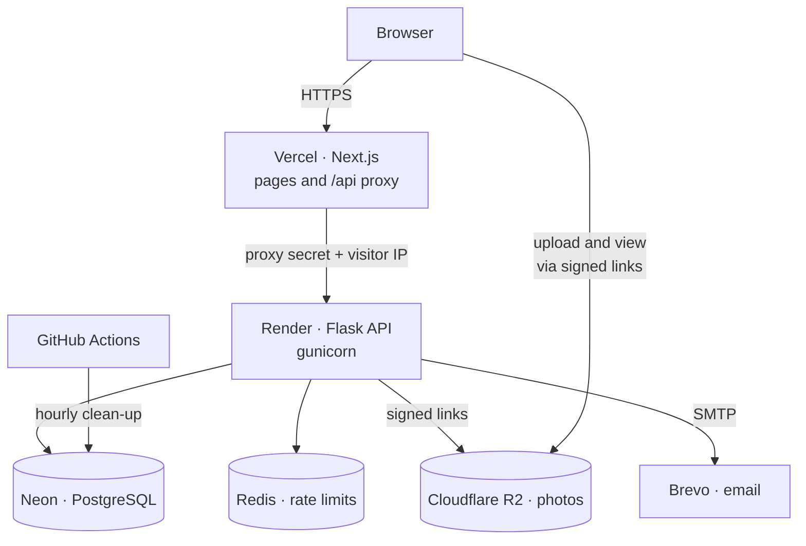

# PropFlow

**Property maintenance, from report to resolved.** Tenants report repairs from their phone,
managers assign contractors, and everyone follows the same status until the job is closed.

[](https://github.com/Griffinsshem/propflow/actions/workflows/ci.yml)
[](https://propflow-omega-tawny.vercel.app)

**[Try the live demo →](https://propflow-omega-tawny.vercel.app)** No account needed: you get a
private sandbox with properties, tenants and a contractor, and can view it as each of them.
It is deleted after 24 hours, and no email is ever sent from it.



## What it does

| | |
|---|---|
| **Owners and managers** | Dashboards of what is new, urgent and overdue; properties, buildings, units and tenants; work orders with due dates; a team with roles |
| **Tenants** | Report repairs with photos; follow progress without phoning anyone; notifications at every step |
| **Contractors** | One list of their jobs; accept or decline with a reason; mark progress and completion |



Every request keeps its full history, and each person sees only their part:





## Architecture



- The browser talks only to the frontend. Its server-side proxy forwards API calls with a
  shared secret, so the API refuses anything that bypasses it, and names the visitor's IP in
  its own header so rate limits key on real people ([ADR 0016](docs/architecture/adr/),
  [ADR 0020](docs/architecture/adr/0020-client-ip-from-the-proxy.md)).
- Photos never pass through the API: browsers upload and view them through short-lived signed
  links, and location data is stripped before they are stored.

## Engineering highlights

**Security.** Opaque server-side sessions with Argon2id password hashing; CSRF protection on
every change; a nonce-based Content Security Policy; roles enforced by the API on every request
from one permission matrix; an append-only audit log; per-account and per-IP rate limits. The
public demo is isolated per visitor, cannot send email (two independent guards), cannot invite,
upload or create organizations, and leaves no trace when deleted
([ADR 0021](docs/architecture/adr/0021-private-demo-sandboxes.md)).

**Correctness.** Concurrent edits are detected with optimistic versioning and shown to the
second editor instead of being overwritten. Maintenance requests and work orders move through
explicit state machines, with every transition recorded.

**Testing.** Every change runs, in CI: 368 API tests (unit, integration and security, against
PostgreSQL), 76 frontend unit tests, and 43 browser journeys with Playwright against the real
API, plus linting, type checks, formatting, dependency audits and a secret scan.

**Decisions.** Twenty-one architecture decision records explain the choices and their
trade-offs, from sessions and permissions to the zero-cost deployment.

## Stack

| Layer | Technology |
|---|---|
| Frontend | Next.js 16 (App Router), TypeScript, Tailwind CSS, TanStack Query, React Hook Form, Zod |
| API | Python 3.12, Flask 3.1, flask-smorest, SQLAlchemy 2, Alembic, Celery, gunicorn |
| Data | PostgreSQL 16, Redis 7, Cloudflare R2 (S3-compatible) |
| Testing | pytest, Vitest, Playwright |
| Hosting | Vercel (frontend), Render (API), Neon (database), Brevo (email), GitHub Actions (CI and scheduled jobs) |

## Running it locally

Requirements: Python 3.12, Node 22, PostgreSQL 16 and Redis 7 running locally, and a `.env` at
the repository root (see `.env.example`).

```bash
scripts/dev.sh                                   # API, worker, scheduler and frontend
cd backend && python scripts/seed_demo.py        # demo accounts, printed with their password
python3 scripts/mailbox.py                       # read the emails the app "sent"
```

The step-by-step guide, including a hand-test checklist, is in
[docs/operations/local-run.md](docs/operations/local-run.md).

**Tests:**

```bash
cd backend && pytest                               # API
cd frontend && npm run test                        # frontend units
cd frontend && npx playwright test                 # browser journeys (API on port 5000)
```

## Deployment

The live site runs on free plans ([ADR 0019](docs/architecture/adr/0019-free-plan-deployment.md)):
`render.free.yaml` for the API, Vercel for the frontend, Neon for the database. The paid
production design is `render.yaml`. The runbook, including the live verification record, is in
[docs/operations/deployment.md](docs/operations/deployment.md).

## Architecture decisions

All records are in [docs/architecture/adr](docs/architecture/adr/):

| | Decision |
|---|---|
| 0001 | Vercel for the frontend, Render for the API, no Docker |
| 0002 | UUID keys, fixed roles, RESTRICT foreign keys |
| 0003 | Opaque sessions, Argon2id, HMAC-based CSRF |
| 0004 | Redis rate limiting keyed by account and IP |
| 0005 | Organization context, a central permission matrix, the audit log |
| 0006 | The property hierarchy and optimistic concurrency |
| 0007 | Tenant profiles, unit placement and occupancy |
| 0008 | The maintenance status machine |
| 0009 | Photos on Cloudflare R2 through signed uploads |
| 0010 | Contractor records and contractor logins |
| 0011 | Background tasks: inline or Celery |
| 0012 | Photo processing and scheduled jobs in the worker |
| 0013 | Role dashboards |
| 0014 | Production deployment and sizing |
| 0015 | Email over SMTP, with retries |
| 0016 | The frontend proxy, nonce CSP and CSRF |
| 0017 | Local storage for development and tests |
| 0018 | Contractor access to request photos |
| 0019 | A zero-cost first deployment |
| 0020 | The visitor's IP from the proxy, not a hop count |
| 0021 | A private demo sandbox per visitor |

## Licence

Copyright © 2026 Griffins Shem. **All rights reserved.** The code is published for reading
and evaluation; no licence is granted to use, copy, modify or distribute it.
